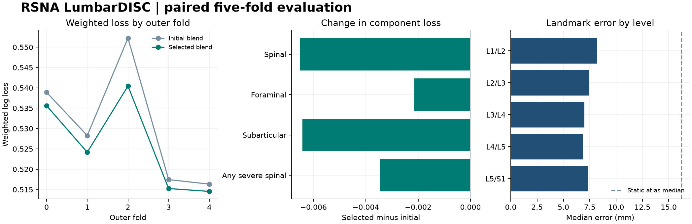
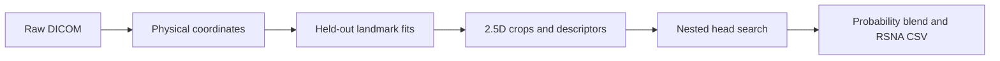

# RSNA Lumbar Spine MRI Grading

DICOM geometry, nested landmark localization, and severity grading at five lumbar levels.

**0.8534 macro AUROC** and **0.5260 weighted log loss** over five held-out folds. The AUROC interval is 0.8472–0.8599.

Selected configuration `incumbent+raw-0.15`. See the [discrimination audit](DISCRIMINATION.md), [experiment report](REPORT.md), [search trajectories](figures/search.png), [aggregate metrics](metrics.json), and [synthetic prediction example](examples/README.md).



## Dataset

| Unit | Count |
| --- | ---: |
| Training studies across folds | 1,975 |
| Held-out study–target predictions | 49,375 |
| Local unlabeled test studies | 1 |

The public score is a paired comparison across five outer folds. The local test has one unlabeled study and verifies the 25-row submission. Supply `-HistoricalOof` and `-HistoricalSubmission` to match the reported historical reference. The workflow can also build a fresh localized reference. [RSNA challenge](https://www.rsna.org/artificial-intelligence/ai-image-challenge/lumbar-spine-degenerative-classification-ai-challenge) · [Dataset paper](https://doi.org/10.1148/ryai.250480)

## Workflow



The project uses a pinned [shared training engine](https://github.com/ThorsenH1/medimage-ml-lab) and has a task-specific runner. The published artifact contains source, aggregate benchmark results, and synthetic examples. Dataset files, checkpoints, and individual evaluation predictions stay in local storage.

## Reproduce the experiment

Use Python 3.11, PowerShell 7, and a CUDA-capable GPU. The original workstation used an RTX 2080 SUPER with 8 GiB VRAM.

```powershell
python -m venv .venv
$p = './.venv/Scripts/python.exe'
& $p -m pip install torch==2.14.0+cu126 torchvision==0.29.0+cu126 --index-url https://download.pytorch.org/whl/cu126
& $p -m pip install -r requirements.txt
```

Set the data and pretrained weight locations for your machine. The initial ResNet-18 weight directory uses `hub/checkpoints/resnet18-f37072fd.pth`. The Hugging Face cache uses `refs/main` and `snapshots/<revision>/model.safetensors`. Use the Hugging Face snapshot for `timm/resnet18.a1_in1k`. [Initial ResNet-18 weights](https://download.pytorch.org/models/resnet18-f37072fd.pth)

```powershell
$data = 'D:/datasets/spine'
$torchCache = 'D:/models/torch'
$hf = 'D:/models/huggingface/hub'
pwsh -File scripts/Run-Project.ps1 -Task spine -Python $p -DataRoot $data -InitialWeights $torchCache -WeightRoot $hf
```

The runner writes the initial experiment under `artifacts/` and the extended search under `search-artifacts/`. For a larger volume, supply `-Artifacts` and `-Search` and use matching paths at inference. The prepared caches and training stages can resume from saved boundaries.

## Predict from raw input

Use the model selection and checkpoint roots produced by the runner.

```powershell
& $p -m medimage.search_predict spine --selection search-artifacts/runs/spine/selection.json --search search-artifacts/runs/spine --weights $hf --root $data --cache artifacts/cache/spine-test --localization artifacts/spine/localization --incumbent artifacts/inference/spine.csv --output search-artifacts/inference/spine.csv
```

The [example](examples/README.md) runs the selected local models on deterministic synthetic inputs. This is a research and education project.
