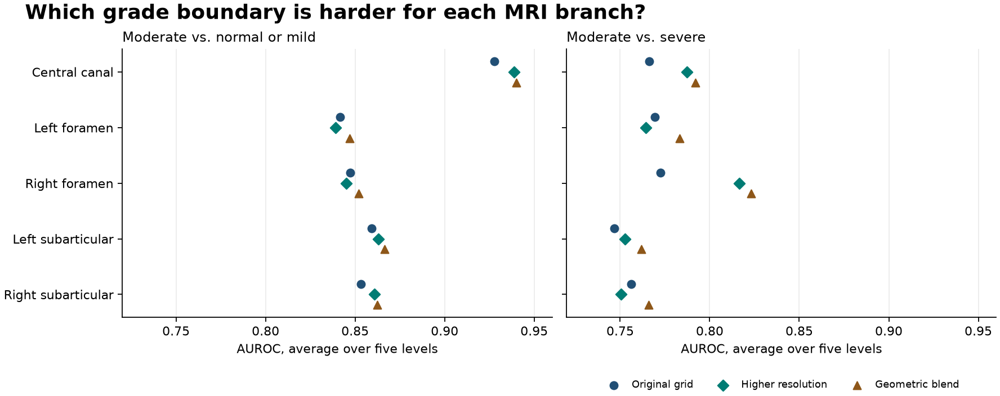
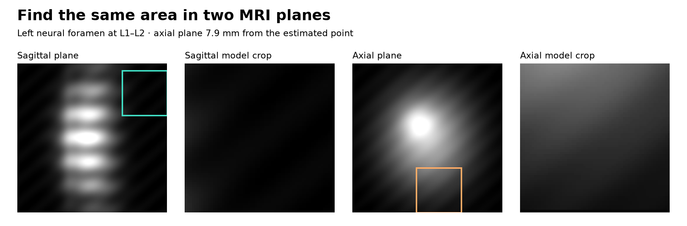

# Improving lumbar MRI localization and grading

The earlier feature ensemble reached **0.8534 macro AUROC** across five held-out folds. Moderate findings were the hardest class at **0.7937**, because they need to be distinguished from the neighboring normal or mild and severe grades. Every severity prediction starts with a crop around an estimated anatomical location. [Earlier discrimination report](DISCRIMINATION.md)

## Teach the model to locate the disc

The original method matched the appearance of a study to a small atlas and estimated disc locations from similar studies. The new model sees three neighboring sagittal slices and produces five heatmaps, one for each disc. A heatmap gives every spatial position a score for how strongly it resembles the center of that disc. The peak and its immediate neighborhood determine the estimated coordinate.

The pilot used three training folds and selected the checkpoint on a fourth fold. I then scored the fifth fold with two copies of the same frozen severity classifier, each using different disc locations.

| Paired comparison on 393 held-out studies | Original localization | Learned heatmaps |
| --- | ---: | ---: |
| Median disc-center error | 7.22 mm | **1.97 mm** |
| Percentage of centers within 10 mm | 66.3% | **95.4%** |
| Macro AUROC across 74 evaluable cells | 0.8558 | **0.8620** |
| Moderate-grade macro AUROC | 0.7903 | **0.8005** |
| Weighted log loss | 0.6230 | **0.6116** |

This is one paired fold with the same classifier on both sides. It isolates the effect of changing its crop positions. Its AUROC can be compared to the baseline in this table. The main project report separately evaluates all five folds.

## Keep each outer-fold study out of the geometry fit

For a complete study-level experiment, the localizer is refit with a fixed 16-epoch budget. Each evaluation study's fold is excluded. A crop for a classifier's training study also excludes that study's own fold. This prevents the grading model from learning on regions generated by a localizer that already saw the study's annotated coordinates.

| Outer fold | Median held-out disc-center error |
| --- | ---: |
| 0 | 1.941 mm |
| 1 | 1.945 mm |
| 2 | 1.894 mm |
| 3 | 1.879 mm |
| 4 | 1.963 mm |

Replacing the crops alone raised AUROC from **0.8597 to 0.8680** for the same five frozen classifiers. The spatial-detail grader then added a branch that preserves where features appear inside a crop. It started with the existing classifier for the same outer fold and used a fixed four-epoch schedule. The equal-weight blend combines the spatial-detail scores with the previous ensemble. [Multi-sequence MRI research](https://www.robots.ox.ac.uk/~vgg/publications/2025/Park25/park25.pdf)

| Metric across 1,975 held-out studies | Previous ensemble | Spatial-detail grader | Equal blend |
| --- | ---: | ---: | ---: |
| Macro AUROC across all 75 cells | 0.8534 | 0.8714 | **0.8740** |
| Macro average precision | 0.5597 | 0.5853 | **0.5916** |
| Weighted log loss | 0.5260 | 0.5789 | **0.4917** |
| Normal or mild AUROC | 0.8657 | 0.8835 | **0.8862** |
| Moderate AUROC | 0.7937 | 0.8086 | **0.8156** |
| Severe AUROC | 0.9007 | **0.9220** | 0.9203 |

The equal blend has a 95% study-bootstrap AUROC interval of **0.8685–0.8793**. The overall comparison reuses the established folds, and the single local test study has no released grades. I ran the new raw-DICOM inference on that study and verified all 25 probability rows.

## Score the same anatomy from both left–right orientations

The five frozen spatial-detail graders each read an original crop and a left-right reflected crop. Sagittal slices reverse their depth order. Axial images reflect along the axis that the DICOM geometry identifies as closest to patient left–right. The left and right labels then swap back before the model averages the two passes. Studies with incompatible geometry use the original prediction. The orientation check passed for **1,973 of 1,975** held-out studies.

| Metric on the same five held-out folds | Original-crop blend | Original-and-reflected blend |
| --- | ---: | ---: |
| Macro AUROC across 75 cells | 0.8740 | **0.8789** |
| Macro average precision | 0.5916 | **0.5997** |
| Weighted log loss | 0.4917 | **0.4840** |
| Normal or mild AUROC | 0.8862 | **0.8893** |
| Moderate AUROC | 0.8156 | **0.8207** |
| Severe AUROC | 0.9203 | **0.9268** |

The paired AUROC gain was **+0.0049**, with a 95% study-bootstrap interval of **+0.0032 to +0.0066**. The selected blend's AUROC interval was **0.8741–0.8833**. The comparison reuses the project's established folds. I verified the new raw-DICOM inference on the generated study and on the local unlabeled study, each with 25 normalized probability rows.

## Where the classifier still struggles

The original-and-reflected baseline reached **0.9328 macro AUROC** for the central canal and **0.8789** across all five conditions. In the central canal, moderate cases reached **0.9001** when ranked against the other grades. The same comparison was hardest for the two subarticular regions, which are the side passages where nerve roots travel. Left foraminal narrowing gained the most from reflection, increasing from **0.8504 to 0.8615**. Each condition averages its five lumbar levels.


| Condition | Macro AUROC across grades | Moderate vs. all other grades | Moderate vs. severe with the raw moderate score | Moderate vs. severe with the conditional score |
| --- | ---: | ---: | ---: | ---: |
| Central canal | 0.9328 | 0.9001 | 0.5950 | 0.7663 |
| Left foraminal | 0.8615 | 0.8052 | 0.4681 | 0.7514 |
| Right foraminal | 0.8667 | 0.8109 | 0.4691 | 0.7789 |
| Left subarticular | 0.8678 | 0.7946 | 0.5742 | 0.7546 |
| Right subarticular | 0.8657 | 0.7925 | 0.5884 | 0.7605 |

For the last two columns, the audit keeps cases labeled moderate or severe. The conditional score divides the probability of moderate by the sum of the moderate and severe probabilities. On that subset, the result for the left foraminal region rises from 0.4681 to 0.7514. The three-grade evaluation continues to use every available grade.

The four side-region conditions averaged **0.8654 AUROC** at this stage. At the same central-canal score, an overall **0.9000** requires an average of approximately **0.8918** across those four conditions. The next experiment changes the image crops around those regions.

I trained a separate head that first scores abnormality and then estimates severity within abnormal cases. Four recipes competed on an inner validation fold for each outer fold. The best recipe in each inner fold was refit on its outer training studies. The head reached **0.8038 AUROC** alone. A fixed 25% blend with the original-crop ensemble reached **0.8732**.

After reproducing the five-fold comparison, run the grade audit on its saved probabilities.

```powershell
& $p -m medimage.spine_ordinal_audit --root $data --cache $cache `
    --probabilities "$analysis/equal-blend-oof.csv" --output "$analysis/ordinal-audit.json"
& $p -m medimage.spine_ordinal_audit --root $data --cache $cache `
    --probabilities "$laterality/equal-blend-oof.csv" --output "$laterality/ordinal-audit.json" `
    --reference-audit "$analysis/ordinal-audit.json" --figure "$laterality/ordinal-progress.png"
```

## Use a tighter field for the side regions

The side passages are small. I tested a fixed second crop with **80% of the original width and height**, centered on the same point and resized to the same input size. Each frozen fold grader scored it in both orientations wherever DICOM geometry supported reflection. For each of the 20 side targets, the spatial grader contributes 75% of its usual score and 25% of the narrow-crop score. The reference model and spatial grader still contribute half of the final probability each. The five central-canal outputs keep their existing calculation.

| Metric on the same five folds and 1,975 studies | Original-and-reflected baseline | With narrower side crops |
| --- | ---: | ---: |
| Macro AUROC across all 75 cells | 0.8789 | **0.8803** |
| Macro average precision | 0.5997 | **0.6009** |
| Weighted log loss | 0.4840 | **0.4836** |
| Moderate AUROC | 0.8207 | **0.8223** |
| Severe AUROC | 0.9268 | **0.9287** |

The paired AUROC gain was **+0.00134**, with a 95% study-bootstrap interval of **+0.00082 to +0.00188**. The new AUROC interval is **0.8756–0.8845**. The comparison uses the established outer folds. For the local unlabeled test study, the pipeline verifies the DICOM-to-submission workflow. [See the two actual crops and the final synthetic prediction](WHERE-THE-MODEL-LOOKS.md)

## Compare ranking and log loss after adjusting grade weights

During training, the spatial grader weighs normal or mild, moderate, and severe grades at **1, 2, and 4**. I tested a fixed adjustment for the 20 side targets. Divide the spatial grader's three probabilities by the square roots of those training weights, normalize them to sum to one, and then average them with the reference probabilities. The adjustment uses fixed constants and the already computed predictions. The audit uses the same 1,975 held-out studies.

| Metric | Narrower side crops | With partial grade weight adjustment |
| --- | ---: | ---: |
| Macro AUROC | 0.8803 | **0.8809** |
| Macro average precision | 0.6009 | **0.6033** |
| Moderate AUROC | 0.8223 | **0.8263** |
| Severe AUROC | **0.9287** | 0.9270 |
| Weighted log loss | **0.4836** | 0.4877 |

The paired AUROC gain was **+0.00064**, with a 95% study-bootstrap interval of **+0.00033 to +0.00096**. The adjusted model's AUROC interval is **0.8762–0.8854**. It ranks the moderate cases better on these folds. The original narrower-crop model had the lower weighted log loss in this pair. Both configurations can be reproduced with the same trained graders and deployment command.

## Test whether adjacent levels improve the ranking

For each held-out fold, I learned how the grades at neighboring disc levels occur together using the other four folds. When scoring a side target, the model applied a small fixed adjustment from the probabilities at the adjacent levels. The central-canal targets kept their existing calculation. The adjusted macro AUROC was **0.8799**, down **0.00096**, with a paired 95% interval of **−0.00118 to −0.00076**. Weighted log loss fell from 0.4877 to 0.4861. The best AUROC remained **0.8809**, so the published model uses the original scores. This measures the effect of combining probabilities after inference. [See the separate physical crop audit](WHERE-THE-MODEL-LOOKS.md#check-the-crops-against-held-out-anatomical-points)

## Test more widely spaced axial slices

The physical crop audit found that most missed points fell farther than 5 mm from every selected slice. I added a second pass for the ten subarticular targets. It reads the same middle slice and moves both neighboring slices one position farther away. The crop centers are projected into the new planes in physical coordinates. The extra pass contributes 25% of the spatial grader's scores for those targets before grade weight adjustment.

| Metric on the same 1,975 held-out studies | Grade-adjusted model | Extra axial pass |
| --- | ---: | ---: |
| Macro AUROC | 0.88090 | **0.88100** |
| Macro average precision | 0.60331 | **0.60398** |
| Weighted log loss | 0.48771 | **0.48756** |

The paired AUROC increase was **+0.00010**, with a 95% interval of **−0.00006 to +0.00026**. The lower-resolution pipeline kept the simpler recipe at **0.8809 AUROC**. The added axial slices improved anatomical coverage, and the grading interval spans zero. [See the annotated-point coverage](WHERE-THE-MODEL-LOOKS.md#check-the-crops-against-held-out-anatomical-points)

## Preserve more detail from the original DICOM slices

The higher-resolution pass reopens the source DICOMs, renders **256-pixel** slice grids, and projects the same physical regions into them. The five new graders read **128-pixel** crops. Each starts from its corresponding spatial-detail grader and trains for four epochs on the same outer-fold development studies. The predictions use the fixed average of the final three checkpoints. The final model averages the grade-adjusted model above and the higher-resolution model, with the two orientations averaged inside the new branch where geometry supports it.

| Model evaluated on the same 1,975 held-out studies | Macro AUROC | Macro average precision | Weighted log loss |
| --- | ---: | ---: | ---: |
| Grade-adjusted original-grid model | 0.8809 | 0.6033 | 0.4877 |
| Higher-resolution grader alone | 0.8731 | 0.5921 | 0.5830 |
| Equal blend with the higher-resolution grader | 0.8837 | 0.6060 | 0.4811 |
| Equal blend with original and reflected higher-resolution crops | **0.8868** | **0.6126** | **0.4734** |

The selected blend has a 95% study-bootstrap AUROC interval of **0.8822–0.8909**. The paired effect of adding reflection to the higher-resolution grader was **+0.00304 AUROC**, with a 95% interval of **+0.00236 to +0.00371**. Reflection was available for **1,973 of 1,975** held-out studies. Moderate-grade AUROC was **0.8299**, compared with **0.8263** for the earlier grade-adjusted model. The released labels cover the five established outer folds. [Follow one DICOM prediction](WALKTHROUGH.md)

## Compare ways to combine the two grading branches

Each branch returns three numbers for normal or mild, moderate, and severe. The deployed model takes a simple average. I tested two fixed formulas on the same 1,975 held-out studies. The ordinal formula combines the odds of “moderate or severe” and “severe,” then recovers the middle grade by subtraction. The geometric formula takes the square root of the product of the two scores for each grade, then rescales the three values to sum to one.

| Pooling rule | Macro AUROC | Moderate AUROC | Macro average precision | Weighted log loss ↓ |
| --- | ---: | ---: | ---: | ---: |
| Arithmetic average | 0.88676 | 0.82992 | 0.61258 | **0.47336** |
| Ordinal log-odds | 0.88749 | 0.83051 | 0.61426 | 0.48611 |
| Geometric mean | **0.88751** | **0.83054** | **0.61435** | 0.48546 |

The geometric variant gained **0.00075 AUROC**. The paired 95% study-bootstrap interval was **+0.00009 to +0.00133**, based on 855 of 1,000 resamples with all grades present in the benchmark cells. The two alternatives ranked patients slightly better and had higher log loss. Treat this as an exploratory comparison on the existing folds. The usual prediction command uses the arithmetic average, and the walkthrough includes the optional ranking variant on the same generated scan.

## Distinguish moderate from both neighboring grades

Moderate cases can be confused with normal or mild cases and with severe cases. To measure those two errors separately, I compared only the two grades shown in each panel. I divided the moderate score by the sum of the scores for those two grades, then measured AUROC at each disc level and averaged across levels.



The geometric blend ranged from **0.8470 to 0.9399** across anatomical regions for moderate versus normal or mild, and from **0.7617 to 0.8231** for moderate versus severe. In the right neural foramen, the higher-resolution branch reached **0.8164** at the moderate–severe boundary. The original-grid branch reached **0.7726**, and the geometric blend reached **0.8231**. These pairwise measures use selected grades. The main benchmark uses every observed grade.

I then split the severity score into two steps. The model first estimates whether the grade is moderate or severe. It then estimates the share of that score to assign to severe. The three final scores always sum to one. I compared equal weighting and two fixed 75/25 allocations, favoring a different branch at each step. The rules were evaluated on the existing 1,975 outer-fold studies.

| Combination | Macro AUROC | Moderate AUROC | Macro average precision | Weighted log loss ↓ |
| --- | ---: | ---: | ---: | ---: |
| Arithmetic reference | 0.88676 | 0.82992 | 0.61258 | **0.47336** |
| Geometric reference | **0.88751** | 0.83054 | **0.61435** | 0.48546 |
| Two steps, equally weighted | 0.88733 | 0.82999 | 0.61418 | 0.48404 |
| Original grid emphasized in the first step | 0.88322 | 0.82135 | 0.60870 | 0.50421 |
| Higher resolution emphasized in the first step | 0.88743 | **0.83188** | 0.61410 | 0.47476 |

The higher-resolution-first rule assigned 75% of the log-odds weight to the higher-resolution branch in the first step and 75% to the original-grid branch in the second. Its paired overall AUROC change from the geometric reference was **−0.00008**, with a 95% study-bootstrap interval of **−0.00073 to +0.00059**. This rule gives a slightly higher moderate-grade score ranking and lower log loss than the geometric blend. The walkthrough shows what the formula changes for one generated image. [Aggregate boundary and pooling results](figures/grade-boundaries.json) · [Prediction walkthrough](WALKTHROUGH.md)

## Test a second MRI plane for foraminal grading

The foramina are the openings where nerves leave the spine. The grading model's main foraminal crop comes from a sagittal image, viewed from the side. I used the crop center and the DICOM orientation to find the same physical location in an axial image, viewed across the spine. The axial crop had to keep its center in frame and within 8 mm of an available plane. The algorithm uses the localizer's estimated coordinates and the image geometry.



The colored rectangles show the field of view in each full image. Each close-up shows the center slice of the corresponding stack. The model uses measurements from the center slice and the available neighbors. In this generated example, the selected axial plane is 7.9 mm from the estimated point, near the 8 mm cutoff. Both crops are near an image edge, which makes the placement easy to inspect before interpreting any score. [Coordinates for the generated example](examples/two-mri-planes.json)

The two experimental learners both use intensity and local contrast measurements from the sagittal crop. One also receives the axial measurements. For each input, two gradient-boosted trees estimate the score for moderate or severe and the proportion of that score assigned to severe. Each learner trains on four folds and scores the fifth. The comparison gives the experimental learner 15% of the geometric blend for the ten foraminal targets and keeps the other fifteen target scores from the geometric reference.

## Reproduce the five-fold comparison

Run the [original training workflow](README.md#reproduce-the-experiment) to generate the reference fold checkpoints and prior selection. The following steps reproduce the new spatial-detail experiment. The five outer-fold classifiers use a fixed schedule and are scored after training.

```powershell
$PSNativeCommandUseErrorActionPreference = $true
$ErrorActionPreference = 'Stop'
$learned = 'search-artifacts/learned-localizer'
$graders = 'search-artifacts/spatial-detail-runs'
$analysis = 'search-artifacts/spatial-detail-assessment'
$laterality = "$analysis/laterality"
$zoom = "$analysis/lateral-zoom"
$gradeWeights = "$analysis/lateral-grade-weights.json"
$gradeOof = "$analysis/grade-adjusted-oof.csv"
$plan = "$zoom/deployment-auroc.json"
$cache = 'artifacts/cache/spine-train'
$folds = 'artifacts/spine/folds.csv'
$localizer = 'artifacts/spine/localization'
$reference = 'search-artifacts/runs/spine'

& $p -m medimage.spine_heatmap_crossfit --cache $cache --folds $folds `
    --reference $localizer --output $learned --epochs 16 --batch 32
foreach ($fold in 0..4) {
    & $p -m medimage.spine_train --root $data --cache $cache --folds $folds `
        --localization $learned --weights $torchCache --parent "artifacts/spine/runs/fold-$fold/final.pt" `
        --output "$graders/fold-$fold" --fold $fold --epochs 4 --batch-size 10 --spatial-detail --seed 9391
}
& $p -m medimage.spine_grade_compare --root $data --folds $folds --runs $graders `
    --baseline "$reference/selected-oof.csv" --output $analysis --bootstrap 1000
& $p -m medimage.spine_laterality --root $data --cache $cache --folds $folds --regions $learned `
    --runs $graders --reference "$reference/selected-oof.csv" --comparison $analysis `
    --output $laterality --batch 3 --bootstrap 1000
& $p -m medimage.spine_lateral_zoom --root $data --cache $cache --folds $folds --regions $learned `
    --runs $graders --reference "$reference/selected-oof.csv" --comparison $analysis --laterality $laterality `
    --output $zoom --batch 3 --bootstrap 1000
& $p -m medimage.spine_weight_audit --root $data --cache $cache --folds $folds `
    --reference "$reference/selected-oof.csv" --zoom $zoom --output $gradeWeights `
    --predictions-output $gradeOof --bootstrap 1000
& $p -m medimage.spine_detail_infer lock --train-cache $cache --folds $folds `
    --learned $learned --reference $localizer --runs $graders --comparison "$analysis/metrics.json" `
    --reference-selection "$reference/selection.json" --laterality-report $laterality --zoom-report $zoom `
    --grade-weight-report $gradeWeights --output $plan
```

For the lower-log-loss model, use a separate output path for the deployment plan and omit `--grade-weight-report` from the lock command.

To reproduce the adjacent-level experiment, run the following after the grade weight audit.

```powershell
& $p -m medimage.spine_context_audit --root $data --cache $cache --folds $folds `
    --reference "$reference/selected-oof.csv" --zoom $zoom --grade-weight-report $gradeWeights `
    --output "$analysis/adjacent-level-context.json"
```

Run the [physical coverage audit](WHERE-THE-MODEL-LOOKS.md#check-the-crops-against-held-out-anatomical-points) before measuring the extra axial pass.

```powershell
& $p -m medimage.spine_slice_context --root $data --cache $cache --folds $folds `
    --reference "$reference/selected-oof.csv" --regions $learned --runs $graders --zoom $zoom `
    --grade-weight-report $gradeWeights --support-report "$analysis/crop-support.json" `
    --output "$analysis/wide-axial" --batch 2 --bootstrap 1000
```

To repeat the ordinal-head experiment, use the nested feature bank from the [earlier discrimination workflow](DISCRIMINATION.md).

```powershell
$features = 'search-artifacts/features/spine'
& $p -m medimage.spine_ordinal_fit --root $data --cache $cache --folds $folds --features $features `
    --reference "$analysis/equal-blend-oof.csv" --output "$analysis/ordinal" --threads 2 --epochs 10 --batch 48
```

For the controlled crop-only comparison, run `medimage.spine_crop_compare` with the same data, cache and folds, the original classifiers, and both region directories. Start with the [prediction walkthrough](WALKTHROUGH.md) to see what the new localizer and graders receive on one example.

### Reproduce the higher-resolution model

Run this after creating the original-grid deployment plan and its grade-adjusted held-out predictions above.

```powershell
$nativeCache = "$analysis/native-cache256"
$nativeRegions = "$analysis/native-regions"
$nativeGraders = "$analysis/native-graders"
$nativeComparison = "$analysis/native-comparison"
$nativeReflection = "$analysis/native-reflection"
$nativePlan = "$analysis/native-deployment.json"
& $p -m medimage.spine_native prepare --root $data --base $cache --output $nativeCache --size 256 --workers 6
& $p -m medimage.spine_native reproject --base $cache --native $nativeCache --reference $learned `
    --folds $folds --output $nativeRegions
foreach ($fold in 0..4) {
    & $p -m medimage.spine_train --root $data --cache $nativeCache --folds $folds --localization $nativeRegions `
        --weights $torchCache --parent "$graders/fold-$fold/final.pt" --output "$nativeGraders/fold-$fold" `
        --fold $fold --epochs 4 --batch-size 8 --spatial-detail --resolution 128 --seed 9451
}
& $p -m medimage.spine_grade_compare --root $data --folds $folds --runs $nativeGraders `
    --baseline $gradeOof --output $nativeComparison --paired --bootstrap 1000
& $p -m medimage.spine_laterality --root $data --cache $nativeCache --folds $folds --regions $nativeRegions `
    --runs $nativeGraders --reference $gradeOof --comparison $nativeComparison --output $nativeReflection `
    --batch 3 --bootstrap 1000
& $p -m medimage.spine_detail_infer lock --train-cache $cache --folds $folds --learned $learned `
    --reference $localizer --runs $nativeGraders --comparison "$nativeComparison/metrics.json" `
    --reference-selection $plan --native-train-cache $nativeCache --native-regions $nativeRegions `
    --laterality-report $nativeReflection --output $nativePlan
```

Compare the score formulas after the reflected native run finishes.

```powershell
$pooling = "$analysis/native-pooling"
& $p -m medimage.spine_pool_audit compare --root $data --folds $folds --original $gradeOof `
    --native-comparison $nativeComparison --reflection $nativeReflection --output $pooling
```

```powershell
$boundaries = "$analysis/grade-boundaries"
& $p -m medimage.spine_grade_boundaries --root $data --folds $folds --original $gradeOof `
    --native-comparison $nativeComparison --reflection $nativeReflection --output $boundaries
```

```powershell
& $p -m medimage.spine_crossplane --root $data --cache $nativeCache --folds $folds `
    --regions $nativeRegions --reference "$pooling/geometric-oof.csv" `
    --output "$analysis/crossplane" --workers 5 --bootstrap 1000
```

Generate the example study and its trace first using the [prediction walkthrough](WALKTHROUGH.md).

```powershell
& $p -m medimage.spine_crossplane_example --cache "$example/cache256" `
    --trace "$example/study-trace.json" --output "$example/crossplane"
```

### Fine-tune the side-region ranking

The ordinary training loss rewards probable grades and emphasizes severe cases. The follow-up also compares two patients at the same side target. For each grade it rewards assigning a higher score to the patient with that grade. Missing grades are skipped. The 20 side targets use this extra loss with a fixed weight of 0.32. Each fold starts from its corresponding higher-resolution grader. The five held-out folds assess the fixed training recipe after four epochs.

| Five-fold comparison | Macro AUROC | Macro average precision | Weighted log loss ↓ |
| --- | ---: | ---: | ---: |
| Existing reflected arithmetic blend | **0.88676** | **0.61258** | **0.47336** |
| Blend with rank-tuned grader | 0.88348 | 0.60219 | 0.50582 |
| Blend with rank-tuned grader and reflection | 0.88578 | 0.60424 | 0.49586 |

The new grader added to the existing ensemble scored lower on both ranking and weighted log loss. In a 393-study pilot on the first fold, I also combined 75% of the original checkpoint and 25% of the rank-tuned checkpoint, parameter by parameter. The resulting single grader reached **0.86437**, compared with **0.86477** for the original grader and **0.86152** for the rank-tuned grader. Blending their predictions with the same weights reached **0.86588**. The pilot uses 74 evaluable grade comparisons on one fold. [Aggregate results for the checkpoint pilot](figures/checkpoint-interpolation-fold0.json) · [Weight interpolation method by Wortsman et al.](https://openaccess.thecvf.com/content/CVPR2022/html/Wortsman_Robust_Fine-Tuning_of_Zero-Shot_Models_CVPR_2022_paper.html)

```powershell
$rankGraders = "$analysis/native-ranking-graders"
$rankComparison = "$analysis/native-ranking-original"
$rankReflection = "$analysis/native-ranking-reflected"
$nativeOof = "$nativeReflection/equal-blend-oof.csv"
foreach ($fold in 0..4) {
    & $p -m medimage.spine_train --root $data --cache $nativeCache --folds $folds `
        --localization $nativeRegions --weights $torchCache --parent "$nativeGraders/fold-$fold/final.pt" `
        --output "$rankGraders/fold-$fold" --fold $fold --epochs 4 --batch-size 8 --spatial-detail `
        --resolution 128 --lateral-ranking-weight 0.32 --seed 9711
}
& $p -m medimage.spine_grade_compare --root $data --folds $folds --runs $rankGraders `
    --baseline $nativeOof --output $rankComparison --paired --bootstrap 1000
& $p -m medimage.spine_laterality --root $data --cache $nativeCache --folds $folds --regions $nativeRegions `
    --runs $rankGraders --reference $nativeOof --comparison $rankComparison --output $rankReflection `
    --batch 3 --bootstrap 1000
```

```powershell
& $p -m medimage.spine_checkpoint_blend --root $data --cache $nativeCache --folds $folds `
    --regions $nativeRegions --parent "$nativeGraders/fold-0" --tuned "$rankGraders/fold-0" `
    --output "$analysis/checkpoint-interpolation/fold-0" --fold 0 --fraction 0.25 --batch 4
```
