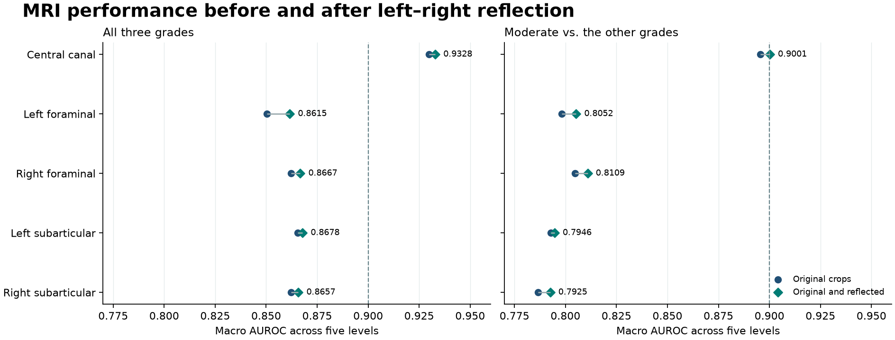

# Improving lumbar MRI localization and grading

The earlier feature ensemble reached **0.8534 macro AUROC** across five held-out folds. Moderate findings were the hardest class at **0.7937**, because they need to be distinguished from the neighboring normal or mild and severe grades. Every severity prediction starts with a crop around an estimated anatomical location. [Earlier discrimination report](DISCRIMINATION.md)

## Teach the model to locate the disc

The original method matched the appearance of a study to a small atlas and estimated disc locations from similar studies. The new model sees three neighboring sagittal slices and produces five heatmaps, one for each disc. A heatmap gives every spatial position a score for how strongly it resembles the center of that disc. The peak and its immediate neighborhood determine the estimated coordinate.

The pilot used three training folds and selected the checkpoint on a fourth fold. I then scored the fifth fold with two copies of the same frozen severity classifier, each using different disc locations.

| Paired comparison on 393 held-out studies | Original localization | Learned heatmaps |
| --- | ---: | ---: |
| Median disc-center error | 7.22 mm | **1.97 mm** |
| Percentage of centers within 10 mm | 66.3% | **95.4%** |
| Macro AUROC across 74 evaluable cells | 0.8558 | **0.8620** |
| Moderate-grade macro AUROC | 0.7903 | **0.8005** |
| Weighted log loss | 0.6230 | **0.6116** |

This is one paired fold with the same classifier on both sides. It isolates the effect of changing its crop positions. Its AUROC can be compared to the baseline in this table. The main project report separately evaluates all five folds.

## Keep each outer-fold study out of the geometry fit

For a complete study-level experiment, the localizer is refit with a fixed 16-epoch budget. Each evaluation study's fold is excluded. A crop for a classifier's training study also excludes that study's own fold. This prevents the grading model from learning on regions generated by a localizer that already saw the study's annotated coordinates.

| Outer fold | Median held-out disc-center error |
| --- | ---: |
| 0 | 1.941 mm |
| 1 | 1.945 mm |
| 2 | 1.894 mm |
| 3 | 1.879 mm |
| 4 | 1.963 mm |

Replacing the crops alone raised AUROC from **0.8597 to 0.8680** for the same five frozen classifiers. The spatial-detail grader then added a branch that preserves where features appear inside a crop. It started with the existing classifier for the same outer fold and used a fixed four-epoch schedule. The equal-weight blend combines the spatial-detail scores with the previous ensemble. [Multi-sequence MRI research](https://www.robots.ox.ac.uk/~vgg/publications/2025/Park25/park25.pdf)

| Metric across 1,975 held-out studies | Previous ensemble | Spatial-detail grader | Equal blend |
| --- | ---: | ---: | ---: |
| Macro AUROC across all 75 cells | 0.8534 | 0.8714 | **0.8740** |
| Macro average precision | 0.5597 | 0.5853 | **0.5916** |
| Weighted log loss | 0.5260 | 0.5789 | **0.4917** |
| Normal or mild AUROC | 0.8657 | 0.8835 | **0.8862** |
| Moderate AUROC | 0.7937 | 0.8086 | **0.8156** |
| Severe AUROC | 0.9007 | **0.9220** | 0.9203 |

The equal blend has a 95% study-bootstrap AUROC interval of **0.8685–0.8793**. The overall comparison reuses the established folds, and the single local test study has no released grades. I ran the new raw-DICOM inference on that study and verified all 25 probability rows.

## Score the same anatomy from both left–right orientations

The five frozen spatial-detail graders each read an original crop and a left-right reflected crop. Sagittal slices reverse their depth order. Axial images reflect along the axis that the DICOM geometry identifies as closest to patient left–right. The left and right labels then swap back before the model averages the two passes. Studies with incompatible geometry use the original prediction. The orientation check passed for **1,973 of 1,975** held-out studies.

| Metric on the same five held-out folds | Original-crop blend | Original-and-reflected blend |
| --- | ---: | ---: |
| Macro AUROC across 75 cells | 0.8740 | **0.8789** |
| Macro average precision | 0.5916 | **0.5997** |
| Weighted log loss | 0.4917 | **0.4840** |
| Normal or mild AUROC | 0.8862 | **0.8893** |
| Moderate AUROC | 0.8156 | **0.8207** |
| Severe AUROC | 0.9203 | **0.9268** |

The paired AUROC gain was **+0.0049**, with a 95% study-bootstrap interval of **+0.0032 to +0.0066**. The selected blend's AUROC interval was **0.8741–0.8833**. The comparison reuses the project's established folds. I verified the new raw-DICOM inference on the generated study and on the local unlabeled study, each with 25 normalized probability rows.

## Where the classifier still struggles

The original-and-reflected baseline reached **0.9328 macro AUROC** for the central canal and **0.8789** across all five conditions. In the central canal, moderate cases reached **0.9001** when ranked against the other grades. The same comparison was hardest for the two subarticular regions, which are the side passages where nerve roots travel. Left foraminal narrowing gained the most from reflection, increasing from **0.8504 to 0.8615**. Each condition averages its five lumbar levels.



| Condition | Macro AUROC across grades | Moderate vs. all other grades | Moderate vs. severe with the raw moderate score | Moderate vs. severe with the conditional score |
| --- | ---: | ---: | ---: | ---: |
| Central canal | 0.9328 | 0.9001 | 0.5950 | 0.7663 |
| Left foraminal | 0.8615 | 0.8052 | 0.4681 | 0.7514 |
| Right foraminal | 0.8667 | 0.8109 | 0.4691 | 0.7789 |
| Left subarticular | 0.8678 | 0.7946 | 0.5742 | 0.7546 |
| Right subarticular | 0.8657 | 0.7925 | 0.5884 | 0.7605 |

For the last two columns, the audit keeps cases labeled moderate or severe. The conditional score divides the probability of moderate by the sum of the moderate and severe probabilities. On that subset, the result for the left foraminal region rises from 0.4681 to 0.7514. The three-grade evaluation continues to use every available grade.

The four side-region conditions averaged **0.8654 AUROC** at this stage. At the same central-canal score, an overall **0.9000** requires an average of approximately **0.8918** across those four conditions. The next experiment changes the image crops around those regions.

I trained a separate head that first scores abnormality and then estimates severity within abnormal cases. Four recipes competed on an inner validation fold for each outer fold. The best recipe in each inner fold was refit on its outer training studies. The head reached **0.8038 AUROC** alone. A fixed 25% blend with the original-crop ensemble reached **0.8732**.

After reproducing the five-fold comparison, run the grade audit on its saved probabilities.

```powershell
& $p -m medimage.spine_ordinal_audit --root $data --cache $cache `
    --probabilities "$analysis/equal-blend-oof.csv" --output "$analysis/ordinal-audit.json"
& $p -m medimage.spine_ordinal_audit --root $data --cache $cache `
    --probabilities "$laterality/equal-blend-oof.csv" --output "$laterality/ordinal-audit.json" `
    --reference-audit "$analysis/ordinal-audit.json" --figure "$laterality/ordinal-progress.png"
```

## Use a tighter field for the side regions

The side passages are small. I tested a fixed second crop with **80% of the original width and height**, centered on the same point and resized to the same input size. Each frozen fold grader scored it in both orientations wherever DICOM geometry supported reflection. For each of the 20 side targets, the spatial grader contributes 75% of its usual score and 25% of the narrow-crop score. The reference model and spatial grader still contribute half of the final probability each. The five central-canal outputs keep their existing calculation.

| Metric on the same five folds and 1,975 studies | Original-and-reflected baseline | With narrower side crops |
| --- | ---: | ---: |
| Macro AUROC across all 75 cells | 0.8789 | **0.8803** |
| Macro average precision | 0.5997 | **0.6009** |
| Weighted log loss | 0.4840 | **0.4836** |
| Moderate AUROC | 0.8207 | **0.8223** |
| Severe AUROC | 0.9268 | **0.9287** |

The paired AUROC gain was **+0.00134**, with a 95% study-bootstrap interval of **+0.00082 to +0.00188**. The new AUROC interval is **0.8756–0.8845**. The comparison uses the established outer folds. For the local unlabeled test study, the pipeline verifies the DICOM-to-submission workflow. [See the two actual crops and the final synthetic prediction](WHERE-THE-MODEL-LOOKS.md)

## Compare ranking and log loss after adjusting grade weights

During training, the spatial grader weighs normal or mild, moderate, and severe grades at **1, 2, and 4**. I tested a fixed adjustment for the 20 side targets. Divide the spatial grader's three probabilities by the square roots of those training weights, normalize them to sum to one, and then average them with the reference probabilities. The adjustment uses fixed constants and the already computed predictions. The audit uses the same 1,975 held-out studies.

| Metric | Narrower side crops | With partial grade weight adjustment |
| --- | ---: | ---: |
| Macro AUROC | 0.8803 | **0.8809** |
| Macro average precision | 0.6009 | **0.6033** |
| Moderate AUROC | 0.8223 | **0.8263** |
| Severe AUROC | **0.9287** | 0.9270 |
| Weighted log loss | **0.4836** | 0.4877 |

The paired AUROC gain was **+0.00064**, with a 95% study-bootstrap interval of **+0.00033 to +0.00096**. The adjusted model's AUROC interval is **0.8762–0.8854**. It ranks the moderate cases better on these folds. The original narrower-crop model remains the best measured choice for the competition's weighted log loss. Both configurations can be reproduced with the same trained graders and deployment command.

## Reproduce the five-fold comparison

Run the [original training workflow](README.md#reproduce-the-experiment) to generate the reference fold checkpoints and prior selection. The following steps reproduce the new spatial-detail experiment. The five outer-fold classifiers use a fixed schedule and are scored after training.

```powershell
$PSNativeCommandUseErrorActionPreference = $true
$ErrorActionPreference = 'Stop'
$learned = 'search-artifacts/learned-localizer'
$graders = 'search-artifacts/spatial-detail-runs'
$analysis = 'search-artifacts/spatial-detail-assessment'
$laterality = "$analysis/laterality"
$zoom = "$analysis/lateral-zoom"
$gradeWeights = "$analysis/lateral-grade-weights.json"
$plan = "$zoom/deployment-auroc.json"
$cache = 'artifacts/cache/spine-train'
$folds = 'artifacts/spine/folds.csv'
$localizer = 'artifacts/spine/localization'
$reference = 'search-artifacts/runs/spine'

& $p -m medimage.spine_heatmap_crossfit --cache $cache --folds $folds `
    --reference $localizer --output $learned --epochs 16 --batch 32
foreach ($fold in 0..4) {
    & $p -m medimage.spine_train --root $data --cache $cache --folds $folds `
        --localization $learned --weights $torchCache --parent "artifacts/spine/runs/fold-$fold/final.pt" `
        --output "$graders/fold-$fold" --fold $fold --epochs 4 --batch-size 10 --spatial-detail --seed 9391
}
& $p -m medimage.spine_grade_compare --root $data --folds $folds --runs $graders `
    --baseline "$reference/selected-oof.csv" --output $analysis --bootstrap 1000
& $p -m medimage.spine_laterality --root $data --cache $cache --folds $folds --regions $learned `
    --runs $graders --reference "$reference/selected-oof.csv" --comparison $analysis `
    --output $laterality --batch 3 --bootstrap 1000
& $p -m medimage.spine_lateral_zoom --root $data --cache $cache --folds $folds --regions $learned `
    --runs $graders --reference "$reference/selected-oof.csv" --comparison $analysis --laterality $laterality `
    --output $zoom --batch 3 --bootstrap 1000
& $p -m medimage.spine_weight_audit --root $data --cache $cache --folds $folds `
    --reference "$reference/selected-oof.csv" --zoom $zoom --output $gradeWeights --bootstrap 1000
& $p -m medimage.spine_detail_infer lock --train-cache $cache --folds $folds `
    --learned $learned --reference $localizer --runs $graders --comparison "$analysis/metrics.json" `
    --reference-selection "$reference/selection.json" --laterality-report $laterality --zoom-report $zoom `
    --grade-weight-report $gradeWeights --output $plan
```

For the lower-log-loss model, use a separate output path for the deployment plan and omit `--grade-weight-report` from the lock command.

To repeat the ordinal-head experiment, use the nested feature bank from the [earlier discrimination workflow](DISCRIMINATION.md).

```powershell
$features = 'search-artifacts/features/spine'
& $p -m medimage.spine_ordinal_fit --root $data --cache $cache --folds $folds --features $features `
    --reference "$analysis/equal-blend-oof.csv" --output "$analysis/ordinal" --threads 2 --epochs 10 --batch 48
```

For the controlled crop-only comparison, run `medimage.spine_crop_compare` with the same data, cache and folds, the original classifiers, and both region directories. Start with the [prediction walkthrough](WALKTHROUGH.md) to see what the new localizer and graders receive on one example.
