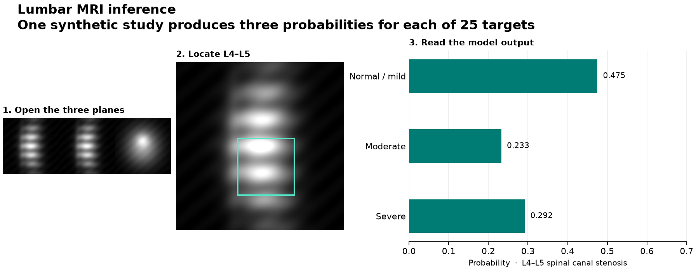

# Follow one lumbar MRI prediction

This example uses a synthetic MRI study made from mathematical patterns. It shows how the trained model turns image slices into probabilities for a specific location in the spine.



## 1. Open the study

A study contains a stack of DICOM files for each acquisition. DICOM stores the image pixels and the physical position and orientation of each slice. The [example preview](examples/phantom.png) shows two sagittal sequences from the side and one axial sequence from above. The data generator creates the full slice stacks.

## 2. Locate the anatomy

The localizer estimates the positions of five disc levels. Using the DICOM geometry, the pipeline finds the slices and extracts a small region around each estimate. The box in the figure is the actual region selected by the first fold's localizer for spinal canal stenosis at L4–L5. Other targets can use different sequences and locations.

## 3. Read the model output

A residual image encoder describes the crops. Five models trained on different study folds score those representations. The selected prediction blends their average with the established reference model. The [trace](examples/study-trace.json) records the fold scores, the reference fraction and the resulting probabilities.

| L4–L5 spinal canal narrowing | Normal or mild | Moderate | Severe |
| --- | ---: | ---: | ---: |
| Reference model | 0.4505 | 0.2385 | 0.3110 |
| Average of five feature-model folds | 0.6150 | 0.2006 | 0.1844 |
| Final blend | **0.4752** | **0.2328** | **0.2920** |

The final blend uses **85%** of the reference and **15%** of the feature-model scores. Each of the 25 rows has three probabilities summing to one. The input is generated for this demonstration. [Full example JSON](examples/prediction.json)

## 4. Generate the study and rerun the selected model

Use the Python environment and training artifacts from the [training workflow](README.md#reproduce-the-experiment). This example includes the model-generated [reference probabilities](examples/synthetic-reference.csv) for the generated study. The trained feature models and localizers come from your local run.

```powershell
$example = 'search-artifacts/synthetic-spine'
& $p -m medimage.demo spine --output $example
& $p -m medimage.search_predict spine --selection search-artifacts/runs/spine/selection.json `
    --search search-artifacts/runs/spine --weights $hf --root $example --cache "$example/cache" `
    --localization artifacts/spine/localization --incumbent examples/synthetic-reference.csv `
    --output "$example/prediction.csv" --trace "$example/study-trace.json"
& $p -m medimage.workflow_figure spine --examples $example --cache "$example/cache" `
    --trace "$example/study-trace.json" --output "$example/workflow.png"
```

Find the L4–L5 spinal canal row in the CSV and check that the three columns sum to 1. The published scores use a specific set of trained weights. A freshly trained run can produce different scores.

## 5. Understand the evaluation

| What can go wrong | How the experiment addresses it |
| --- | --- |
| Reversed slice order points the model to the wrong anatomy | Use physical DICOM coordinates to order slices and find each plane |
| A localizer memorizes an evaluation study | Fit the localizer without that study's outer fold |
| A confident model confuses the moderate grade with its neighbors | Show AUROC for each grade and report a probability-sensitive log loss |
| The local test has no reference grades | Score the model on five held-out study folds and check file generation on the local test |

The reported model reached **0.8534 macro AUROC** on the held-out predictions for 1,975 studies. It averages 75 comparisons across findings, levels and grades. The competition metric is **0.5260 weighted log loss** in the same folds. The local test study verifies that the system produces 25 rows. [Full discrimination report](DISCRIMINATION.md)
