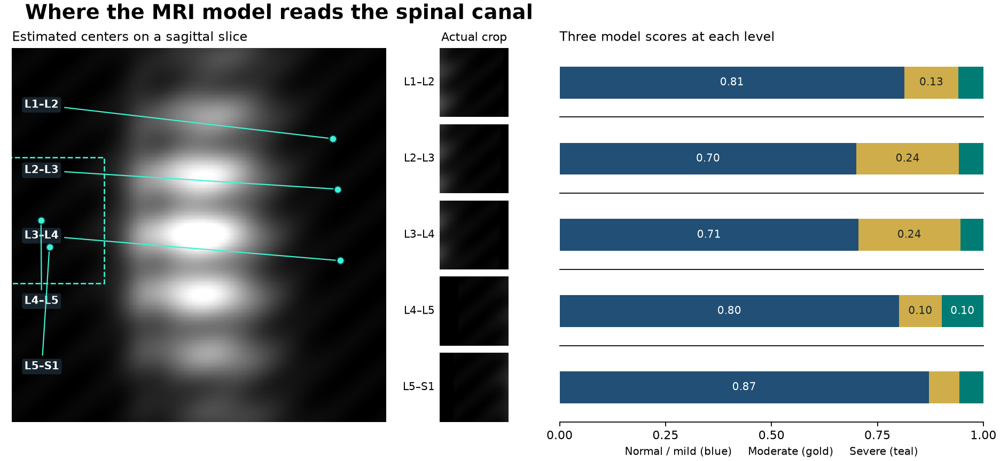
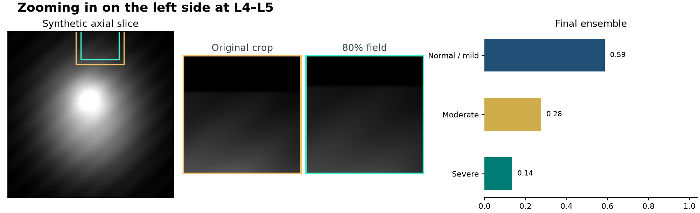
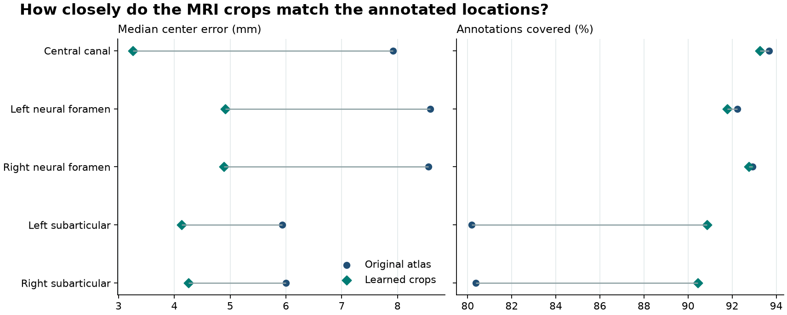

# See the regions the MRI grader actually reads



The turquoise points are the learned localizer's estimated centers for the five disc levels. The dashed box shows the central crop for L4–L5. Each thumbnail is the central slice from the exact three-slice high-resolution crop the first fold's grader received. The colored bars use the final ensemble, which combines the original-grid model with those higher-resolution graders.

Some estimated centers miss the bright column in this generated image. The resulting crops near the edge are dark. The model still produces probabilities, so a score alone cannot tell you whether the model had a good view. This example shows why inspecting crop placement matters. [Complete trace with coordinates and scores](examples/study-trace.json)

The overlay shows the regions supplied to the grading model. The trace records how the original and reflected passes changed each grade probability. For grading and localization benchmarks, use the study-level [research results](RESEARCH.md). Follow the [end-to-end walkthrough](WALKTHROUGH.md) to generate the example and rebuild the figure.

## Compare two views of the same side region



This view shows one step inside the original-grid branch. The boxes outline the regular crop in gold and the 20% narrower crop in turquoise. The target is narrowing in the left passage where a nerve root travels. The two crops use the same center and output size. In this synthetic study, the localizer placed the center near the upper edge, so both crops include black padding. The original-grid branch still assigns **0.59** to normal or mild. Look at the crop placement before interpreting that score. The synthetic study has no clinical grade. [Original-grid prediction trace](examples/grade-adjusted-trace.json)

```powershell
& $p -m medimage.spine_region_explain --cache "$example/cache256" `
    --trace "$example/study-trace.json" --output "$example/where-model-looked.png"
& $p -m medimage.spine_region_explain --cache "$example/cache" `
    --trace "$example/grade-adjusted-trace.json" --output "$example/original-grid-regions.png" `
    --zoom-output "$example/lateral-zoom.png"
```

## Check the crops against held-out anatomical points

A grader reads three cropped slices for each target. I checked whether the dataset's annotated point projects into one of those rectangles within **5 mm** of the slice plane. The 5 mm is a fixed tolerance for this audit. The results cover **48,692 annotated targets in 1,974 studies**. Each study was excluded from its localizer's training fold.

| Anatomical target | Annotated points | Original atlas | Learned crops | Learned crops with narrower sides |
| --- | ---: | ---: | ---: | ---: |
| Central canal | 9,753 | 93.7% | 93.3% | 93.3% |
| Left neural foramen | 9,860 | 92.2% | 91.8% | 91.2% |
| Right neural foramen | 9,859 | 92.9% | 92.7% | 92.1% |
| Left subarticular passage | 9,608 | 80.2% | **90.9%** | 90.8% |
| Right subarticular passage | 9,612 | 80.4% | **90.4%** | 90.4% |
| All targets | 48,692 | 87.9% | **91.8%** | 91.6% |

The learned crops lowered the median distance from the marker to the crop center on the nearest selected slice from **7.25 mm to 4.47 mm**. A marker inside the crop tells us that the grader had an image of the marked location. The grade can still be wrong, and a point gives no information about the shape or extent of the finding. [See the grading results](RESEARCH.md)



For the learned crops, **3,159 of the 3,981 missed points** had no selected slice within 5 mm. Giving the side-passage grader a second stack with more widely spaced slices covered **166 additional points**. Left subarticular coverage increased from 90.85% to 91.63%, and right coverage increased from 90.44% to 91.39%. [See whether the added coverage improved grading](RESEARCH.md#test-more-widely-spaced-axial-slices)

```powershell
& $p -m medimage.spine_crop_support --cache $cache --folds $folds `
    --reference $localizer --learned $learned --output "$analysis/crop-support.json" `
    --figure "$analysis/crop-coverage.png"
```
